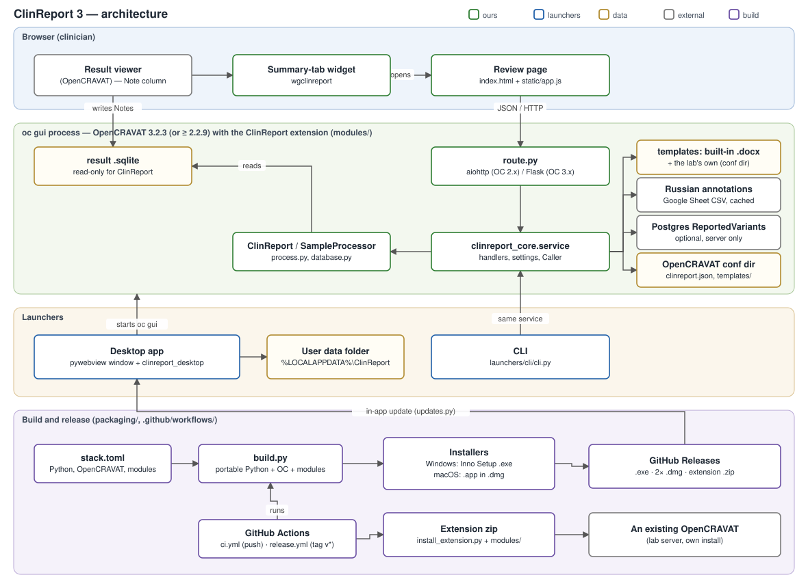

# Architecture

How ClinReport is put together, where each kind of change belongs, and the invariants the code relies on. Details live in
[reference/](reference/); the reasons in [decisions/](decisions/README.md). Diagram:
[architecture.drawio.svg](architecture.drawio.svg) (open it in draw.io or the VS Code draw.io extension to edit).



## The problem

A clinician gets an OpenCRAVAT result (`*.sqlite`, one or more samples), marks the variants to report in the **Note**
column, and needs a Word report per sample in the lab's format, checked and edited by a person before it is saved. The
report content is a fixed mapping from Note codes and annotation columns to template fields; the templates belong to the
lab and change more often than the code.

## Bird's-eye view

Everything clinicians use is an **OpenCRAVAT extension** made of two modules: a *webapp* (review page + Python HTTP routes)
and a *webviewerwidget* (the button on the result's Summary tab). OpenCRAVAT loads both into its own `oc gui` process;
there is no separate server. Around that extension sit two **launchers** that reuse it unchanged — the **desktop app**
(bundles Python + OpenCRAVAT + the extension and runs them for one user) and the **CLI** — and the **packaging** that turns
the repository into installers and an extension zip.

```
 OpenCRAVAT result viewer ──Summary tab──► widget wgclinreport ──opens──► review page (index.html + static/app.js)
                                                                              │ JSON over HTTP
                                                                              ▼
 oc gui process:  route.py (aiohttp for OC 2.x / Flask for OC 3.x) ──► clinreport_core.service ──► ClinReport/SampleProcessor
                                                                              │                       │ reads (never writes)
                                                                              │                       ▼
                                                                              │                   result .sqlite
                                                                              ├─► templates/*.docx + the lab's own (conf dir) → docxtpl → .docx
                                                                              ├─► Russian annotations (Google Sheet CSV, cached 10 min)
                                                                              └─► Postgres "ReportedVariants" (optional, server only)

 Desktop app:  ClinReport window (pywebview) ─► clinreport_desktop ─starts─► oc gui (bundled Python + OpenCRAVAT + modules)
                                              └─ calls clinreport_core.service in-process for templates and settings
 CLI:          launchers/cli/cli.py ─► clinreport_core.service (same documents as «Сохранить как…»)
```

Request flow of a report (from [reference/http-api.md](reference/http-api.md)):

```
page load        GET  open?dbpath=…            → samples, file name, settings
«Обработать»     POST process {dbpath,target,mode} → one context per report (+ layouts, warnings)
(edit in page)   the page edits report.context in place — no request
«Сохранить как…» POST render {context,kind,template,filename} → .docx bytes → saved by the browser
«Выгрузить…»     POST upload {context}         (server edition with a database)
```

The server is **stateless between requests**: the full, edited context travels back with `render`/`upload`.

## Codemap

| Where | What lives there | Change it for |
|---|---|---|
| `modules/webapps/clinreport/clinreport_core/service.py` | every request handler (dict in → dict or `FileResult` out), settings, caches, the `Caller` (login mode) | a new action, a setting, a rule about who may do what |
| `…/clinreport_core/process.py` | `SampleProcessor`: variant rows → template context (sections, interpretation text) | what the report says |
| `…/clinreport_core/database.py` | `VariantSource` (reads the result, legacy and new column layouts), Russian annotations, `Database` (Postgres) | reading new OpenCRAVAT columns, the database |
| `…/clinreport_core/templates.py` | built-in templates + the lab's own: store, checks against an example report | template handling |
| `…/clinreport_core/labels.py` | page layouts (`LAYOUTS`: tables, columns, what is editable) and the database payload | columns, section titles |
| `modules/webapps/clinreport/route.py` | the HTTP adapter: aiohttp (OC 2.x) or Flask (OC 3.x), login detection | only when OpenCRAVAT's GUI changes |
| `modules/webapps/clinreport/{index.html,static/}` | the review page (vanilla JS, no build step) | UI |
| `modules/webapps/clinreport/templates/` | the built-in `.docx` templates (DZM, FND, 10x) | the lab's standard documents |
| `modules/webviewerwidgets/wgclinreport/` | the Summary-tab button | the viewer entry point |
| `launchers/desktop/clinreport_desktop/` | window (`ui/`, `api.py`), OpenCRAVAT process (`server.py`), single instance + mutex (`instance.py`), data paths (`paths.py`), updates (`updates.py`) | desktop-only behaviour |
| `launchers/desktop/clinreport_oc_compat.py` | start-up patches that make OpenCRAVAT 3.2.3 work on Windows | OpenCRAVAT bumps |
| `launchers/cli/cli.py` | command line on `service` | CLI options |
| `packaging/build.py`, `stack.toml` | portable Python + OpenCRAVAT + modules → `packaging/dist/ClinReport`, installers; the pinned versions | builds, versions |
| `packaging/windows/ClinReport.iss`, `packaging/macos/` | Windows installer (Inno Setup), macOS `.app`/`.dmg` | install/update behaviour |
| `packaging/install_extension.py` | adds the modules to an existing OpenCRAVAT | the extension route |
| `tests/` | pytest by area (`core`, `routes`, `cli`, `desktop`, `packaging`); `e2e/` scripts need a running `oc gui` | with every change |

## Invariants

These hold everywhere; several are things the code deliberately does **not** do, so they cannot be read from it.

- **The extension is the product.** The desktop app and the CLI contain no report logic; they call `clinreport_core.service`.
  A feature that exists only in a launcher is a bug ([ADR 0004](decisions/0004-features-live-in-the-extension.md)).
- **Nothing writes to a result `.sqlite`.** Only OpenCRAVAT's viewer (via the `wgnote` widget) writes Notes; ClinReport reads.
- **No secrets and no user data in a module folder.** OpenCRAVAT serves `modules/webapps/` as static files and replaces
  module folders on update. Settings and the lab's templates live in the OpenCRAVAT conf dir; the database connection
  comes only from the server's environment ([ADR 0007](decisions/0007-user-data-outside-program-folders.md)).
- **Module code imports no OpenCRAVAT at module level, no pandas/numpy, and stays Python 3.8-compatible**, so it runs in
  any OpenCRAVAT from 2.2.9 and is testable without one ([ADR 0005](decisions/0005-module-code-python-3-8-compatible.md)).
  The package name `clinreport_core` is unique on purpose: OpenCRAVAT loads all modules into one process.
- **Handlers are framework-free**; `route.py` is the only file that knows aiohttp or Flask. Route paths are one segment.
- **One pinned stack** (`packaging/stack.toml`): the desktop app, CI and the dev environment run the same OpenCRAVAT and
  Python ([ADR 0008](decisions/0008-pin-opencravat-3-2-3-and-python-3-13.md)).
- **One version number** for the product and both modules ([ADR 0014](decisions/0014-one-version-number.md)).
- **An update replaces program files only**: the installer deletes `{app}\python` and `{app}\modules` and nothing else; the
  desktop launcher re-syncs our modules into the user's modules folder and leaves Store modules alone
  ([ADR 0010](decisions/0010-windows-installer-per-user-inno-setup.md)).

## Desktop app at run time

```
%LOCALAPPDATA%\Programs\ClinReport\        read-only program (replaced by updates)
├── python\                                 python-build-standalone CPython + open-cravat + deps + clinreport_desktop
├── modules\                                base modules (hg38, wgnote, excelreporter) + ours
└── bundle.json                             versions, managed modules, update repository

%LOCALAPPDATA%\ClinReport\                  the user's data (kept by updates and uninstall)
├── conf\                                   cravat-system.yml (written per start), clinreport.json, clinreport\templates\
├── modules\  jobs\  logs\  workspace\      OpenCRAVAT's folders for this user
├── python-packages\                        Python packages of Store modules
└── updates\                                downloaded installers (deleted on the next start)
```

macOS: the program is `ClinReport.app/Contents/Resources/ClinReport`, the data `~/Library/Application Support/ClinReport`.

On start the launcher: hands a second start over to the running window; stops OpenCRAVAT processes left by a crash;
writes OpenCRAVAT's system conf for this user (so another OpenCRAVAT on the computer is untouched); syncs the bundled
modules; starts `oc gui --headless` on a free port; checks for updates. Closing the window stops everything. Details:
[development/packaging.md](development/packaging.md).

## Threading and state

- aiohttp runs handlers in a thread pool, OpenCRAVAT 3.x's waitress in 12 threads → handlers may run concurrently.
- Module state in `service.py`: the Russian-annotation cache (locked), the Postgres engine cache (not locked; worst case two
  engines, [issue clinreport/018](issues/clinreport/018-thread-safety.md)); settings files are written atomically under a lock.
- The desktop launcher keeps its state in the `App` object; background threads (server start, update check, download)
  only replace whole dicts, which the window polls.
